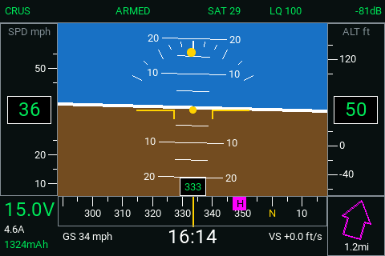
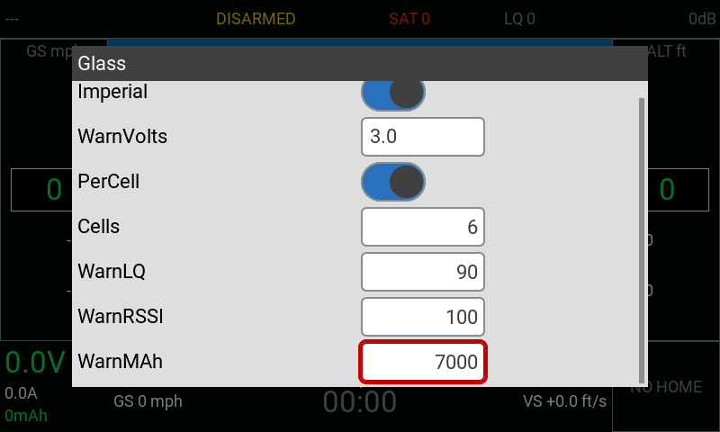
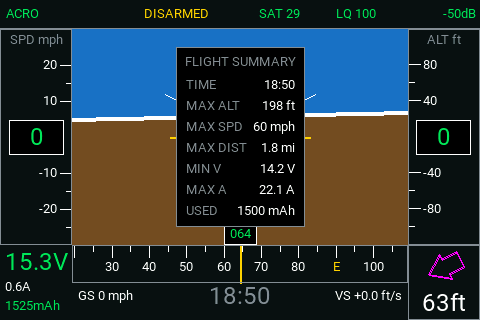
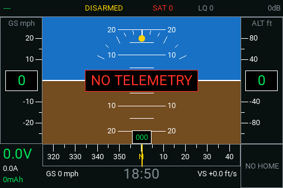

# Glass: a glass-cockpit telemetry widget for EdgeTX and ArduPilot

*An EdgeTX color-screen widget for ArduPilot aircraft flown over ExpressLRS or Crossfire (CRSF). Setup guide and user manual.*

## Overview

Glass turns the color screen of your EdgeTX radio into a "glass cockpit" display for ArduPilot. It shows an artificial horizon with a pitch ladder and bank scale, speed and altitude tapes with a vertical-speed bar, a heading tape, battery and link status, a home arrow with distance, a flight timer, and a flight summary after landing. It is inspired by the look of a real aircraft's primary flight display.

It reads ArduPilot's "passthrough" telemetry carried over CRSF, plus the standard CRSF telemetry sensors, so it works with ExpressLRS and Crossfire links.

**Tested with:** ArduPilot (fixed-wing), ExpressLRS 2.4 GHz at 100 Hz Full and 333 Hz Full with a 1:2 telemetry ratio, on a RadioMaster TX16S MK3 (800x480 screen), a GX15 (480x320 screen), and a TX16S MK2 (480x272 screen). The layout adapts to screen sizes from 320x240 up to 800x480, but the smaller sizes have not been tested. Crossfire should behave the same as ExpressLRS but has not been tested at this time.

**Not supported:** FrSky S.Port or F.Port passthrough. This widget reads CRSF telemetry only. It is designed for fixed-wing aircraft; multirotors have not been tested, and the compass logic in particular assumes an aircraft that flies forward.

## What you need

- An EdgeTX radio with a color screen. EdgeTX 2.11 or newer is required. The widget has seven options, and EdgeTX versions before 2.11 allow at most five options per widget.
- An ExpressLRS or Crossfire link that passes CRSF telemetry to the radio.
- An ArduPilot flight controller (Plane recommended), version 4.2 or newer, with the receiver connected to a serial port.
- A GPS with a good lock for the best results.

## Quick start

1. Connect the receiver to a flight controller UART with both wires (TX and RX), and set that port's protocol to 23 (RCIN).
2. Add the passthrough, "flight mode annotation" and ExpressLRS bits to `RC_OPTIONS` (see Part 1).
3. Reboot the flight controller.
4. On the radio, power up the aircraft, link, and run **Discover new sensors** on the model's Telemetry page.
5. Copy `main.lua` to `SD:/WIDGETS/Glass/main.lua`.
6. Add the "Glass" widget to a screen that uses a single full-size zone.
7. Open the widget's settings and choose your units and any warning thresholds (all warnings are off by default).
8. Check that the horizon moves when you tilt the aircraft, that the flight mode shows, and that ARMED and DISARMED change when you arm.

## Part 1: ArduPilot setup

### 1.1 Receiver wiring and serial port

Connect the receiver to a spare UART on the flight controller. Wire the receiver's TX to the UART's RX **and** the receiver's RX to the UART's TX.

Then set the protocol for that UART (replace `x` with the UART number):

- `SERIALx_PROTOCOL` = **23** (RCIN)
- `RSSI_TYPE` = **3** (receiver protocol), so ArduPilot gets link statistics from the receiver

Only one port should be set to protocol 23. Changing a serial protocol takes effect after a reboot.

### 1.2 RC\_OPTIONS

`RC_OPTIONS` is a bitmask. Each option you want is a bit; add the values together and add them to whatever your current `RC_OPTIONS` value is (if you have not changed it, it is probably 0).

| Bit | Value | Option | Needed? |
| --- | --- | --- | --- |
| 8 | 256 | Use passthrough extensions for CRSF telemetry | **Required.** Without it the widget only gets the slow standard attitude data. |
| 12 | 4096 | Annotate flight mode with `*` on disarm | **Required.** Glass decides armed or disarmed from this mark on the flight-mode text. Without it the widget will always think the aircraft is armed. |
| 9 | 512 | Suppress CRSF mode/rate messages for ELRS systems | Recommended for ExpressLRS. Stops harmless warnings in the ground station. |
| 13 | 8192 | Use 420 kbaud for the ELRS protocol | Recommended for ExpressLRS, whose receivers talk to the flight controller at 420 kbaud. |

Example for ExpressLRS starting from 0: 256 + 512 + 4096 + 8192 = **13056**.

If `RC_OPTIONS` already has other bits set, keep them and add these. For example, if it is currently 32 (bit 5, require throttle at idle to arm), the new value is 32 + 13056 = 13088.

### 1.3 Battery monitor

The voltage, current and mAh readouts come from ArduPilot's battery monitor. Make sure `BATT_MONITOR` is set for your power module (voltage and current), and that the voltage and current calibration are correct. The mAh figure is only as accurate as the current sensor calibration.

### 1.4 GPS and home

ArduPilot sets its own home position when you arm, using GPS. Glass mirrors this: it takes the aircraft's position from just before arming as home, so the home arrow and distance should closely match ArduPilot's. You need a GPS lock for the home arrow, the altitude tape (which is measured from home), and the compass.

## Part 2: ExpressLRS settings

Use a recent ExpressLRS (tested with 3.x and 4.1.0), with the same major version on the transmitter and the receiver. In the radio's ExpressLRS Lua script, set:

- **Packet rate:** 100 Hz Full or faster. The "Full" modes have more room for telemetry than the non-Full modes.
- **Telemetry ratio:** 1:2 was used for all development and testing.

A higher packet rate did not change how often passthrough values arrived in testing, because ArduPilot sends passthrough packets at its own limited rate. Typical rates seen on the 100 Hz Full, 1:2 setup:

| Value | Updates per second |
| --- | --- |
| Attitude (pitch and roll) | about 5 |
| Speed and AHRS yaw | about 1 to 2 |
| GPS course | about 3 |
| Altitude | about 1 |

Glass lightly smooths attitude, altitude, heading, vertical speed and speed so they do not move in visible steps.

If you also use the Yaapu widget, remove it from this model's screens while using Glass. Both read the same passthrough frame queue and can take frames from each other.

## Part 3: EdgeTX setup

### 3.1 Radio telemetry and sensors

1. Make sure the RF module (internal or external) is set up for CRSF/ExpressLRS and that you see link quality (RQly) and RSSI on the radio.
2. With the aircraft powered and linked, open the model's **Telemetry** page and choose **Discover new sensors**.
3. You should see about 20 sensors. Glass uses these:
   - `GPS`, `GSpd`, `Hdg`, `Sats`: position, ground speed, GPS course, satellite count
   - `FM`: flight mode text
   - `RxBt`, `Curr`, `Capa`: battery voltage, current and mAh used
   - `RQly`, `1RSS`: link quality and RSSI
   - `Alt`, `GAlt`, `VSpd`, `Ptch`, `Roll`, `Yaw`, `ASpd`: standard attitude, altitude and speed sensors, used as a fallback if passthrough is not arriving
4. Passthrough values (attitude, speed, altitude above home) do not appear as sensors. Glass reads them directly, so you will not see them on the sensors page.
5. Keep the radio's own unit setting for telemetry sensors on **metric**. Glass does its own conversion to imperial if you turn that option on, so letting the radio convert as well would convert twice.

### 3.2 Install the widget

Copy `main.lua` to this exact path on the radio's SD card (the folder name is case-sensitive on some systems):

`SD:/WIDGETS/Glass/main.lua`

Restart the radio so it finds the new widget.

### 3.3 Add the widget to a screen

1. Open the model's screen settings (the main views setup; the menu names differ a little between EdgeTX versions).
2. Pick a layout with **one zone**, and turn off the top bar, trims, sliders and flight-mode readout for that screen, so the zone covers the whole display.
3. Set that zone's widget to **Glass**.

You do not need the widget's own full-screen mode. If the widget instead shows the message "Set Glass to full screen", the zone is too small; change the layout or switch off more of the screen items.

### 3.4 Open the widget settings

In the same screen setup, select the Glass widget and open its settings. This is where the options below are set. Changes take effect straight away.

## Part 4: Widget options

There are seven options. Every warning is **off by default** (set to 0), so the widget works as a plain display until you choose thresholds.

| Option | Type | Default | What it does |
| --- | --- | --- | --- |
| **Imperial** | on/off | off | Off shows metric (km/h, meters, m/s, km). On shows mph, feet, ft/s and miles. |
| **WarnVolts** | text | 0 | Low-voltage warning, in volts. By default it is for the whole pack; with **PerCell** on it is per cell. Type the value as you would write it, e.g. `14.0` (pack) or `3.5` (per cell). `12,2` and `12.2V` also work. 0 turns it off. |
| **PerCell** | on/off | off | Off: **WarnVolts** is the whole-pack voltage. On: **WarnVolts** is the voltage per cell. |
| **Cells** | number 0 to 12 | 0 | Number of cells in the pack. Only used when **PerCell** is on. 0 detects it automatically from the pack voltage; set it by hand if the detection is wrong (see below). |
| **WarnLQ** | number 0 to 100 | 0 | Link-quality warning, in percent. 0 turns it off. |
| **WarnRSSI** | number 0 to 130 | 0 | Signal-strength warning. Enter a positive number: `95` means -95 dBm. 0 turns it off. |
| **WarnMAh** | number 0 to 30000 | 0 | Warns when the mAh used reaches or passes this value. 0 turns it off. |

### How the warnings behave

When a warning is active, the value flashes red and yellow about once per second. When it is not active, the value is green.

- **WarnVolts:** warns at or below the voltage you set. Once it has tripped, it only clears when the voltage recovers to 2 percent above your setting, so load sag near the threshold does not make it flicker.
- **Per-cell mode (PerCell on):** the pack voltage is divided by the number of cells, and that figure is compared with **WarnVolts**. With **Cells** at 0, the widget works out the cell count from the pack voltage, because no LiPo or LiHV cell is above 4.35 V (for example, 14.8 V is 4 cells). It detects the count only while on the ground, so voltage sag in flight cannot change it. If you connect a very discharged pack (below about 3.3 V per cell), the count can come out one too low, so set **Cells** yourself in that case. The large voltage reading on the display also switches to the voltage per cell (two decimals) while **PerCell** is on.
- **WarnLQ:** warns at or below the percentage. Clears when LQ is 3 points above it.
- **WarnRSSI:** warns when the signal is as weak as, or weaker than, your value. Clears when it is 3 dB stronger.
- **WarnMAh:** warns at or above the value. The mAh counter is the total since the battery was connected, which is what ArduPilot reports, not just the current flight.
- When telemetry is lost entirely, LQ and RSSI turn gray and do not flash. The red "NO TELEMETRY" box takes over.

The satellite count has fixed colors: green at 8 or more, yellow at 6 or 7, red below 6. It is not adjustable.

### Suggested starting points

These are only starting points. Adjust them after you have seen what your normal flights look like.

**Battery voltage (LiPo).** Many pilots use about 3.5 V per cell under load as a first warning. Use a slightly higher number if your pack sags a lot. With **PerCell** on, just type `3.5` whatever the pack size. With **PerCell** off, type the whole-pack voltage from this table:

| Cells | 3.5 V per cell | 3.6 V per cell |
| --- | --- | --- |
| 3S | 10.5 | 10.8 |
| 4S | 14.0 | 14.4 |
| 5S | 17.5 | 18.0 |
| 6S | 21.0 | 21.6 |

For Li-ion packs use a lower per-cell figure (typically about 2.8 to 3.2 V under load, check your cell's data sheet).

**Link quality.** A warning at 90 gives early notice that the link is degrading; 50 only warns when it is getting seriously poor. ExpressLRS normally shows 100 in good conditions.

**RSSI.** Receiver sensitivity depends on the ExpressLRS packet rate (faster rates are less sensitive), so check the sensitivity for your rate in the ExpressLRS documentation. A first value such as `95` (-95 dBm) leaves a large margin on common 2.4 GHz rates. Raise or lower it after a few flights.

**mAh used.** Warn at about 70 to 80 percent of the pack's capacity. For a 5000 mAh pack that is 3500 to 4000. Setting it to 4000 gives a warning once 4000 mAh has been used.

## Part 5: Reading the display

### Top bar

- **Flight mode** (left, green), as sent by ArduPilot.
- **ARMED** (green) or **DISARMED** (yellow).
- **SAT:** number of GPS satellites (green 8 or more, yellow 6 or 7, red below 6).
- **LQ** and **RSSI:** link quality in percent and signal strength in dBm.

### Attitude indicator (center)

Blue sky above and brown ground below, with a white horizon line. The pitch ladder has a line every 5 degrees, with labels every 10. The scale at the top shows bank angle, with a marker that moves as you roll. The yellow wings are the aircraft symbol. The display handles inverted flight.

### Speed tape (left)

Shows the speed in the green box. When ArduPilot has an airspeed estimate (from a sensor or from its own estimation) that is the speed shown; otherwise it is ground speed. The title is "SPD" when it comes from the passthrough data. Ground speed is also shown in the bottom row as **GS**.

### Altitude tape (right)

Shows altitude above home in the green box, using the passthrough altitude once you have 6 or more satellites. Before that it uses the standard barometric altitude. A thin bar beside the box shows vertical speed (full scale is 5 m/s). The vertical speed is also written in the bottom row as **VS**, in m/s, or ft/s with Imperial on.

### Heading tape (bottom center)

A moving compass strip with ticks every 5 degrees, number labels (every 10 degrees where they fit, otherwise every 20 or 30), and N, E, S and W in yellow. The box on the horizon shows the heading as three digits.

**The heading is the GPS course over ground, not the direction the nose points.** It shows where the aircraft is actually going, which is what you want when navigating to home. In a crosswind it can differ from the nose direction by the crab angle.

- Above about 10 km/h (6.2 mph) with 6 or more satellites, the GPS course is used.
- Below that speed during a flight, the last good course is held, because the GPS course is unreliable near a standstill.
- On the ground before you start moving, and after landing, the heading comes from the aircraft's attitude system (the AHRS yaw), so it follows the direction the nose points.

A magenta **H** on the tape marks the direction of home when it is within 45 degrees of your heading.

### Battery (bottom left)

Pack voltage (large), current in amps, and mAh used. The voltage and mAh turn into flashing warnings if you set `WarnVolts` or `WarnMAh`. The large number is the whole-pack voltage, or the voltage per cell (two decimals) when `PerCell` is on.

### Flight timer (bottom center)

Starts at 00:00 when you arm. It is white while the aircraft is flying. About two seconds after you disarm it turns gray and shows the time up to the moment you disarmed, not counting those two seconds. It restarts at the next arming. Past one hour it shows hours, minutes and seconds (HH:MM:SS).

### Home arrow (bottom right)

An arrow that points to home relative to your heading, with the distance below it. Until a home position exists it shows "NO HOME". Home is first set at the first good GPS fix (8 or more satellites) so the arrow works on the ground, and it is set again every time you arm, from the position the aircraft had just before arming. This is designed to match ArduPilot's own home position.

### Flight summary

After a flight that lasted at least 10 seconds, when you have been disarmed for two seconds, a summary box appears over the horizon:

- Flight time
- Maximum altitude
- Maximum speed
- Maximum distance from home
- Minimum battery voltage
- Maximum current
- mAh used during the flight

It stays on the screen until you arm again. It is hidden whenever telemetry is lost, and short arming tests (under 10 seconds) do not replace the previous summary. Altitude, speed and distance are the same values the tapes show, so a very brief peak can read a little lower than the true peak.

### "NO TELEMETRY"

A red box appears over the horizon when link quality, RSSI and battery voltage all read zero.

## Part 6: Troubleshooting

| Symptom | Likely cause and fix |
| --- | --- |
| The widget shows "Set Glass to full screen". | The widget zone is too small. Use a one-zone layout and switch off the top bar, trims and sliders for that screen. |
| Everything is zero or "NO TELEMETRY". | The link is down or the sensors were not discovered. Check that RSSI and LQ show on the radio and run **Discover new sensors** again. |
| The horizon does not move, or moves about once a second. | Passthrough is not arriving. The widget falls back to the slow standard attitude data, which updates about once a second. Check `SERIALx_PROTOCOL` = 23, `RC_OPTIONS` bit 8 (value 256). |
| It always shows ARMED. | `RC_OPTIONS` bit 12 (value 4096, annotate flight mode on disarm) is not set. |
| The flight mode shows as dashes. | The `FM` sensor has not been discovered, or ArduPilot is not sending flight mode. |
| The home arrow shows "NO HOME". | There is no GPS fix yet. It needs 8 or more satellites for the first fix, or 6 or more when you arm. |
| Speeds or altitudes look doubled or wrong. | The radio's own telemetry unit setting is on imperial. Set it to metric and use the widget's Imperial option instead. |
| The voltage or mAh readings are wrong. | Check ArduPilot's battery monitor settings and calibration (Part 1.3). |
| The per-cell voltage warning comes at the wrong time. | The widget may have counted the wrong number of cells, for example if a very discharged pack was connected. Set **Cells** to the number of cells in your pack. |
| Updates look slow. | See the update-rate table in Part 2. Passthrough attitude is about 5 updates per second, and altitude and speed are slower. This is how often ArduPilot sends them. |
| The screen redraws slowly. | On the 800x480 TX16S MK3 the widget redraws about 8 times a second; on a 480x320 GX15 about 18. This is a limit of the radio's drawing speed, not of the telemetry. |

## Part 7: Notes and limits

- Glass reads CRSF telemetry only. FrSky S.Port and F.Port passthrough are not supported.
- The heading is the GPS course, so it is held (not live) at very low speeds, and the compass is not suited to aircraft that hover.
- Altitude is measured from home, so it reads relative to where you armed, not above sea level.
- The widget has seven options, so it needs EdgeTX 2.11 or newer. Versions before 2.11 allow at most five options per widget.
- Fonts and spacing adapt to the screen size automatically. There is no text-size setting.

## Disclaimer

This widget is a convenience display. It is not a certified flight instrument and its values can be delayed, smoothed or wrong, for example if telemetry is lost or a sensor fails. Do not rely on it as the only source of information for the safety of your aircraft or other people. Use it at your own risk.
